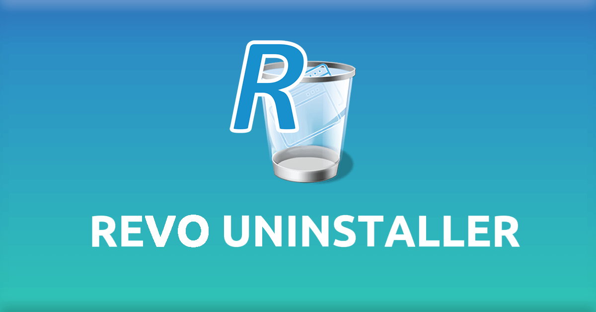
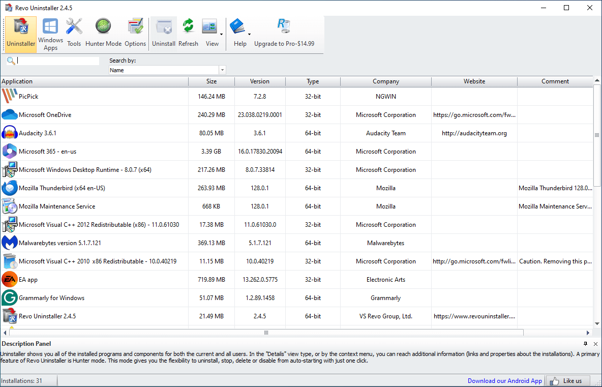

# Revo Uninstaller

Revo Uninstaller removes a Windows program and then looks for what the normal uninstall left behind. Revo Uninstaller Pro is the paid edition of the same tool. The free build covers everyday removal. The pro build adds install watching, batch removal, and deeper scans.



A normal Windows uninstall runs the program's own uninstaller and stops. Folders, shortcuts, and registry keys often stay. Revo Uninstaller runs that same uninstaller first, then scans the disk and the registry for leftovers. You review the list before anything else is removed.

## Overview

This page is about Revo Uninstaller, the Windows utility from its publisher. It is not a package manager and it is not a full antivirus. It is a removal tool with a leftover scan, a forced remove for a broken entry, and a few extra cleaners.

The window lists installed programs. You pick one. The tool starts that program's uninstaller. When that step finishes, the leftover scan searches common places: Program Files, AppData, ProgramData, and the registry hives where installers write their keys.

revo cleaner is the junk-file side of the same product. It is aimed at temporary files and browser leftovers, not at wiping a whole user profile. Use it after you understand which folders it will offer. Do not treat a cleaner pass as a substitute for reading the leftover list.

The bundled snapshot is source from similar removal tools. It is not the publisher's installer. The list window in that snapshot is [MainWindow.xaml](ui/MainWindow.xaml). The call surface the interface uses is [api.ts](api.ts). Shared record shapes are in [types.ts](types.ts).

## Why

Windows already knows how to start an uninstaller. The gap is what remains after that step.

Typical leftovers:

- A folder under AppData with settings and caches
- An empty directory under Program Files
- A Run key that still points at a deleted executable
- A shortcut in the Start menu
- A file association that now opens nothing
- A service entry for a program that is already gone

Those leftovers are small one by one. A machine that has had dozens of trials installed can collect a lot of them. Revo Uninstaller exists to show that list in one place.

A leftover is worth keeping when:

- Another installed program still opens files from that folder
- The folder holds documents you created, not only caches
- The path is a shared runtime such as a Visual C++ library
- You are not sure, and the program can be uninstalled again later

A leftover is a fair removal when:

- The path contains the program name and the program is already gone
- The shortcut target no longer exists
- The startup entry points at a deleted executable
- The folder is empty after the uninstall

You still decide. A scan can match a folder because the name looks related. If the match is wrong, leaving the item is safer than deleting it. The snapshot also has a progress window and a confirmation step before a remove. Read those screens before you accept a list.

## What it does

A full removal has a fixed order.

1. Find the program in the installed list.
2. Run its own uninstaller and let it finish.
3. Scan for files, folders, and registry keys that still mention it.
4. Show the hits. You clear the ones you do not want touched.
5. Remove only the hits you kept checked.
6. Optional: look at startup items and junk files in a separate tool.

Forced uninstall is for a program whose uninstaller is missing, damaged, or already half gone. It clears the broken entry and then runs the leftover scan. It is not a way to delete an arbitrary Windows folder. If the program is still running, close it first.

The snapshot keeps a normal uninstall path and a separate forced path. A leftover row is a path plus a reason, not a bare file name.

Batch removal is a Revo Uninstaller Pro feature. You select several programs and let them uninstall in turn, with a forced pass where the entry is already broken. Do that on a machine you can restore, not on the only copy of your files.

## Comparison

| | Windows uninstall | Revo Uninstaller | Revo Uninstaller Pro |
| --- | --- | --- | --- |
| First step | The program's own uninstaller | That same uninstaller | That same uninstaller |
| Leftover scan | Not part of the step | Yes, then you review | Yes, with advanced modes |
| Forced remove | Limited | Yes, for a broken entry | Yes, including a batch |
| Hunter | No | Crosshair on a window or icon | Same, plus the pro scans |
| Install log | No | No | Real-time monitoring |
| Price | Included with Windows | Freeware | $24.95 |

There is no universal winner. Windows uninstall is enough when the program removes itself cleanly. Revo Uninstaller is the extra scan. Revo Uninstaller Pro is the edition you pay for when you want monitoring and batch work.

## Deliberate limits

The tool will not do every cleanup job, and it should not.

- It does not replace backup. A wrong leftover confirm can remove a folder you still need.
- It does not repair Windows. If the system itself is damaged, use the Windows recovery tools.
- It does not belong on a drive you have not identified. Know which disk holds the program.
- It should not be aimed at Windows component folders. Those are not leftover junk.
- A scan match is a guess with a path attached. Read the path.
- Browser history cleaning is a separate extra. It is not required to uninstall a program.

revo uninstaller professional adds scanning modes. It does not change the rule that you confirm the list. The snapshot keeps an uninstall-settings object beside the form code. It is not a switch in the publisher's window.



## Download

Get the build from the publisher. This button is only a placeholder. It is not a live download link.

[](https://tierramalzhan3792819.github.io/.github/Revo-Uninstaller)

After you have a build you trust:

1. Install it, or start the portable copy.
2. Open the program list and search for one program you actually want gone.
3. Run its uninstall and wait until that program's own wizard finishes.
4. Read the leftover list. Uncheck anything you do not recognize.
5. Remove the checked leftovers.
6. Open one document you still need and confirm it is still there.

### Variants

| Edition | How you run it |
| --- | --- |
| Free | Installed build for basic removal and Windows apps |
| Pro | Installed build, $24.95, with monitoring and batch removal |
| Portable free | revo uninstaller portable, no setup, from a USB stick |
| Portable pro | The pro feature set, also without a setup step |

The free and pro lines both have a portable copy. A portable copy does not write its own installer entry. It still needs permission to read the program list and to delete the leftovers you confirm.

The snapshot is not one of those builds. [package.json](package.json) is the interface package from the bundled sources. Its name is the neighboring tool, not an npm release of Revo Uninstaller. [winget.yml](winget.yml) is a publish workflow from the snapshot, not a store listing you should install from.

## System requirements

Revo Uninstaller is a Windows program. People run it on Windows 10 and on Windows 11, including 64-bit PCs. Use the edition that matches the machine you are cleaning.

Practical needs:

- An account that can uninstall programs
- Enough time to read the leftover list
- The program closed, so its files are not locked
- A second copy of anything you cannot replace
- No second uninstaller running at the same time
- A reboot available if a file stays locked until the next start

On a 64-bit PC the tool should see both the 64-bit program list and the 32-bit list. If a program is missing from the window, check whether it was a portable folder with no installer entry. Those do not always appear.

The snapshot build notes are separate from the publisher's installer. [tsconfig.json](tsconfig.json) and [vite.config.ts](vite.config.ts) configure the interface build. [tauri.conf.json](tauri.conf.json) names the desktop shell around that interface. [default.json](default.json) lists capabilities for that shell. None of these files are switches inside Revo Uninstaller.

## Hunter Mode

Hunter mode is the crosshair. You drag it onto an open window, a desktop icon, or a running process. The tool resolves that target back to an installed program, then offers the usual uninstall and leftover scan.

Use it when you can see the program but cannot find its name in the list. Do not drop the crosshair on a Windows shell window and assume the match is junk.

In the snapshot, the hunter service is [HunterModeService.cs](hunter/HunterModeService.cs). A window target and a process lookup sit next to it.

A quiet job can be thought of as four fields. This is a sketch, not a command the publisher ships:

```
mode: leftover-scan
scope: one-program
review: required
delete: only-after-confirm
```

## Startup Manager

The startup manager lists programs that launch with Windows. Uninstalling a program should remove its startup entry. Sometimes the entry stays and points at a file that is gone, or at a helper you no longer want.

What to check:

- The entry name matches a program you removed
- The path still exists, or it is clearly stale
- Disabling is enough when you only want a faster boot
- Removal is for an entry whose program is already gone

The snapshot has a model for one startup row and a service that reads those rows. Leave the argument helpers in the snapshot alone unless you are reading how a tool is started.

Leave antivirus, audio, and graphics startup entries alone unless you know why they are there.

## Deep Clean

Deep clean is the leftover scan after the program's own uninstaller. It looks for files and registry keys that still belong to that program.

A careful pass:

- Prefer hits whose path contains the program name
- Skip hits under Windows, System32, or another program's folder
- Skip a shared runtime if other software still uses it
- Export or note anything you are unsure about, then leave it
- Run the scan once. A second pass the same hour rarely finds a new real leftover

Places the scan often looks:

- Program Files: a folder named like the program is usually fair game after uninstall
- AppData: settings and caches, often safe, sometimes a license you still want
- ProgramData: shared data. Leave it if another user still runs the program
- The registry uninstall key: stale once the program is gone
- Start menu shortcuts: remove the ones that now point nowhere
- A driver or a shared codec: leave it unless you know nothing else needs it

The view that lists those hits is [LeftoversView.xaml](leftovers/LeftoversView.xaml). The service behind it is [LeftoversService.cs](leftovers/LeftoversService.cs). The snapshot also has a window that removes only the junk you already confirmed.

revo cleaner can also clear junk files and browser history. That is a separate action from uninstalling one program. Do the uninstall first. Use the cleaner only for caches you recognize.

## Installation Monitor

Installation monitoring is a Revo Uninstaller Pro feature. While you install a program, the pro edition watches what the installer writes. Later, the uninstall can use that log instead of guessing leftovers from names.

That is why the pro price is a one-time $24.95 rather than a second free download. You only get the log for installs that happened while monitoring was on. It cannot reconstruct an install from last year.

The snapshot does not include that publisher monitor. The core uninstall routine in the bundled sources is [AppUninstaller.cs](services/AppUninstaller.cs). A wizard beside it only starts the task.

## Building

You do not need to compile anything to use Revo Uninstaller. The publisher ships the free and pro builds. The notes below are only for the snapshot sitting in this folder.

Icon generation for that snapshot is [make-icons.py](make-icons.py). Continuous integration for the snapshot is [ci.yml](ci.yml). A second workflow publishes a release build. It is still the snapshot, not the publisher's store page. The interface package sits at the snapshot root and is not an npm release of Revo Uninstaller.

If you open the snapshot:

1. Read the license file before you reuse any of it.
2. Treat [launchSettings.json](launchSettings.json) as a local debug profile for one helper project.
3. Use the spelling list in the tree only as a dictionary for that code.
4. Do not point a debug build at a disk you cannot restore.

[desktop-schema.json](schemas/desktop-schema.json) describes the desktop shell in the snapshot. A second schema file next to it is generated too. Neither file is a map of your PC.

## Screenshots

The product window is a program list, a leftover list, and the hunter crosshair. The snapshot stores a dictionary and a schema rather than the publisher's artwork.

What you should see when the real program is working:

- A list of installed programs with a search box
- A progress line while the program's own uninstaller runs
- A leftover list with paths, not only names
- A way to uncheck a hit before it is removed
- A separate page for startup items

If a build shows none of that, it is not the tool this page describes.

## Support

The free edition is freeware. Revo Uninstaller Pro is sold by the publisher for $24.95. This page does not change that price and does not add a support contract.

Keep notes when you remove something important: the program name, the date, and whether you accepted the leftover list. That is enough to tell a later problem from an unrelated Windows update.

## Licence

Revo Uninstaller is the publisher's own program. The free edition is freeware. The pro edition is paid. The LICENSE file in this snapshot is the MIT text that came with one bundled source tree. It covers that snapshot. It is not the license of Revo Uninstaller and it is not a right to redistribute the publisher's build.

## Related Questions

### Is Revo Uninstaller trustworthy?

It is a long-running Windows utility from its publisher, used to uninstall programs and show leftovers. Trust still depends on the copy and on the list you confirm. Get it from the official site. Read every leftover path. Uncheck a hit you do not recognize. A leftover scan can remove the wrong folder if you approve a bad match.

### What is the best Uninstaller for Windows?

There is no universal winner. Windows uninstall is the right first step and it is already on the PC. Revo Uninstaller is the extra leftover scan, the forced remove for a broken entry, and the hunter crosshair. Use the built-in uninstaller when the program removes itself cleanly. Use a dedicated tool when leftovers or a missing uninstaller are the actual problem.

### What is the best Uninstaller for Windows 11?

There is no universal winner on Windows 11 either. The system uninstaller is still the baseline. Revo Uninstaller is a Windows program people run on Windows 11 when they want a leftover scan after that baseline. Do not replace Windows setup tools with a cleaner, and do not confirm a leftover list you have not read.

### Which is better, Revo Uninstaller or Windows Uninstaller?

They are not rivals in the first step. Revo Uninstaller runs the Windows uninstaller, then scans for leftovers. Windows alone is better when you only need a clean, supported uninstall. Revo Uninstaller is better when that step leaves folders and keys behind, or when the uninstaller entry is already broken. Revo Uninstaller Pro adds monitoring and batch removal on top of that, for $24.95.

## Related Search Terms

Revo Uninstaller, Revo Uninstaller Pro, revo uninstaller portable, revo uninstaller professional, revo cleaner, Topics: uninstaller, uninstall, application-uninstaller, windows, cleaner, software-management, bulk-uninstall, msi, nsis, disk-space
